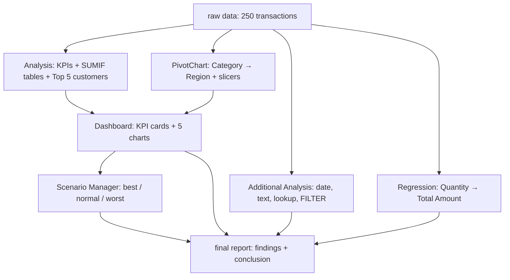

<div align="center">

# 📊 Sales Performance Dashboard

### Excel Final Project

**Dashboards · Pivot Charts · Scenario Manager · Advanced Formulas · Regression**

Created by **✨ Vaidehi Vyas ✨**


*💬 A transaction list is just a long column of numbers until Excel is asked the right questions.*

</div>

<br>

<div align="center">

| 📁 9 | 🧾 250 | 💰 2,29,192.47 | 🌍 5 | 📈 5 |
|:-:|:-:|:-:|:-:|:-:|
| **Worksheets** | **Transactions** | **Total revenue** | **Regions** | **Dashboard charts** |

</div>

### ⚡ At a Glance

| 🏆 Top Region | 🛒 Top Category | 💎 Top Segment | 👑 Top Customer | 📉 Regression R² |
|:-:|:-:|:-:|:-:|:-:|
| **East**<br>25.9% | **Electronics**<br>74.9% | **Premium**<br>36.9% | **Mark Carter**<br>15,659.65 | **0.21**<br>p < 0.001 |

---

## Table of Contents

1. [📌 Overview](#overview)
2. [🎯 Problem Statement](#problem-statement)
3. [✨ Key Features](#key-features)
4. [🗂️ Project Structure](#project-structure)
5. [🔄 Project Workflow](#project-workflow)
6. [🧮 Part A — Raw Data & Analysis Formulas](#part-a--raw-data--analysis-formulas)
7. [📊 Part B — Dashboard: KPIs & Charts](#part-b--dashboard-kpis--charts)
8. [🎛️ Part C — Pivot Chart, Slicers & Conditional Formatting](#part-c--pivot-chart-slicers--conditional-formatting)
9. [🔮 Part D — Scenario Manager](#part-d--scenario-manager)
10. [🧰 Part E — Additional Analysis Functions](#part-e--additional-analysis-functions)
11. [📈 Part F — Regression Analysis](#part-f--regression-analysis)
12. [🛠️ Tech Stack](#tech-stack)
13. [💡 Results & Insights](#results--insights)
14. [🐞 Known Quirks & Fixes](#known-quirks--fixes)
15. [🚀 Advantages](#advantages)
16. [📜 License](#license)
17. [👩‍💻 Author](#author)
18. [🙏 Acknowledgements](#acknowledgements)

---

## Overview

**Sales Performance Dashboard** is a hands-on **Microsoft Excel** workbook (`final_project.xlsx`) built around one idea: a transaction table becomes useful once it can **summarize itself, expose its best customers and products, and answer "what if?"**. Across nine worksheets, the workbook takes 250 sales transactions and turns them into KPIs, charts, a pivot chart with slicers, scenarios, a set of advanced formulas, and a regression model.

> [!TIP]
> New here? Start with the **Dashboard** sheet for the big picture, then open **Analysis** to see how every number is calculated.

This project is designed to:

- Calculate **KPIs** such as total revenue, transactions, quantity sold, and average transaction value
- Summarize sales by **region, product, customer segment, and customer** using `SUMIF`
- Build a **Dashboard** with KPI cards, five charts, and interactive **slicers**
- Build a **PivotChart** that breaks revenue down by Category → Region
- Rank the **Top 5 customers** using `LARGE`, `INDEX`, and `MATCH`
- Test outcomes with the **Scenario Manager** (best / normal / worst case)
- Demonstrate date, text, lookup, and **dynamic-array (`FILTER`)** functions
- Measure how **Quantity** drives **Total Amount** with **Regression** from the Data Analysis ToolPak

---

## Problem Statement

> **Objective:** Given a list of sales transactions — customers, products, categories, quantities, prices, payment methods, regions, and segments — use Excel's built-in tools to analyze sales performance, customer spending, product performance, and regional sales, then present the findings on a dashboard.

The raw data looks like everyday retail records: who bought what, where, how many, and how they paid. The task is to let Excel do the analysis.

| Sheet | Type | Description |
|-------|------|-------------|
| `scenario analysis` | Input | Best / normal / worst case expected sales and a target cell |
| `PivotChart interactive` | Pivot + Chart | Sum of Total_Amount by Category → Region, with slicers |
| `Scenario Summary` | Output | Scenario Manager summary report |
| `Dashboard` | Report | 4 KPI cards, 5 charts, and slicers |
| `raw data` | Data | 250 transactions across 14 columns |
| `regression analysis` | Output | Full ToolPak regression summary and ANOVA |
| `final report` | Report | Project objective, findings, and conclusion |
| `Additional Analysis` | Formulas | Date, text, lookup, and `FILTER` function demos |
| `Analysis` | Calculations | KPI table, `SUMIF` summaries, and Top 5 customers |

---

## Key Features

| Feature | Description |
|---------|-------------|
| 📑 **Nine Themed Worksheets** | Each sheet isolates one analysis technique so it can be studied on its own |
| 🔢 **Live KPI Cards** | Total Revenue, Total Transactions, Total Quantity Sold, and Average Transaction Value update automatically |
| 🧩 **Region / Product / Segment Summaries** | `SUMIF` tables feed the dashboard's column, stacked column, and pie charts |
| 🎚️ **Interactive PivotChart** | Category and Region slicers filter the pivot chart on two sheets |
| 🥇 **Top 5 Customers** | A unique-customer list plus `LARGE` + `INDEX` + `MATCH` ranks customers by total spending |
| 🔺 **Icon-Set Highlighting** | 3-arrow icon sets on customer spending columns, and a value rule on filtered results |
| 🔮 **Scenario Manager** | Three named scenarios with a generated Scenario Summary report |
| ⚙️ **Dynamic Arrays** | `FILTER` returns high-value transactions (≥ 4,000 and ≥ 2,000) |
| 📉 **Statistical Modeling** | Regression of Total Amount on Quantity (R² = 0.2098, p ≈ 2.26 × 10⁻¹⁴) |

---

## Project Structure

```
excel-sales-dashboard/
│
├── final_project.xlsx              Main workbook (9 worksheets)
│   ├── scenario analysis           Scenario inputs (best / normal / worst)
│   ├── PivotChart interactive      Category → Region pivot + chart + slicers
│   ├── Scenario Summary            Scenario Manager report
│   ├── Dashboard                   KPI cards, 5 charts, slicers
│   ├── raw data                    250 transactions, 14 columns
│   ├── regression analysis         ToolPak regression output
│   ├── final report                Objective, findings, conclusion
│   ├── Additional Analysis         TODAY, EOMONTH, DATEDIF, FILTER, and more
│   └── Analysis                    KPIs, SUMIF tables, Top 5 customers
│
└── README.md                       Project documentation
```

---

## Project Workflow



---

## Part A — Raw Data & Analysis Formulas

### Raw Data

The `raw data` sheet holds **250 transactions** (`TRX0001`–`TRX0250`) dated **11 April 2024 – 11 April 2025**, in columns `A:N`.

| Column | Field | Example |
|:------:|-------|---------|
| A | Transaction_ID | TRX0155 |
| B | Date | 2024-04-11 |
| C | Customer_ID | CUST023 |
| D | Customer_Name | Paul Baker |
| E | Product_ID | P009 |
| F | Product_Name | Monitor |
| G | Category | Electronics |
| H | Quantity | 3 |
| I | Unit_Price | 249.99 |
| J | Payment_Method | Cash |
| K | Region | Central |
| L | Customer_Segment | Basic |
| M | Customer_Since | 2021-08-17 |
| N | Total_Amount | 749.97 |

The data covers **50 customers**, **10 products**, **3 categories** (Electronics, Furniture, Appliances), **5 regions**, **3 segments**, and **4 payment methods**. `Total_Amount` equals `Quantity × Unit_Price` on every row.

### Analysis Sheet

The `Analysis` sheet is the calculation engine behind the dashboard.

| Metric | Formula | Value |
|--------|---------|------:|
| Total Revenue | `=SUM('raw data'!N2:N251)` | **2,29,192.47** |
| Total Transactions | `=COUNTA('raw data'!A2:A251)` | **250** |
| Total Quantity Sold | `=SUM('raw data'!H2:H251)` | **753** |
| Average Transaction Value | `=AVERAGE('raw data'!N2:N251)` | **916.77** |
| Highest Transaction | `=MAX('raw data'!N2:N251)` | **4,499.95** |
| Lowest Transaction | `=MIN('raw data'!N2:N251)` | **59.99** |
| Number of Customers | `=SUMPRODUCT(('raw data'!C2:C251<>"")/COUNTIF('raw data'!C2:C251,'raw data'!C2:C251&""))` | **50** |

Summary tables use `SUMIF`:

```excel
=SUMIF('raw data'!K$2:K$251, A14, 'raw data'!N$2:N$251)     ← revenue by region
=SUMIF('raw data'!F$2:F$251, D14, 'raw data'!H$2:H$251)     ← units sold by product
```

Top customers are built in three steps:

```excel
D33: =IFERROR(INDEX('raw data'!$D$2:$D$251, MATCH(0, INDEX(COUNTIF($D$32:D32,'raw data'!$D$2:$D$251)+IF('raw data'!$D$2:$D$251="",1,0),0,0),0)),"")   ← unique customer list
B33: =SUMIF('raw data'!$D$2:$D$251, A33, 'raw data'!$N$2:$N$251)                                                                                              ← total spending
H33: =LARGE($B$33:$B$82, ROWS(H$33:H33))                                                                                                                      ← k-th largest spend
F33: =INDEX($A$33:$A$82, MATCH(H33, $B$33:$B$82, 0))                                                                                                          ← name of that customer
```

---

## Part B — Dashboard: KPIs & Charts

The `Dashboard` sheet pulls its KPIs from the `Analysis` sheet and displays five charts plus slicers.

### KPI Cards

| KPI | Formula | Value |
|-----|---------|------:|
| Total Revenue | `=Analysis!B4` | **2,29,192.47** |
| Total Transactions | `=Analysis!B5` | **250** |
| Total Quantity Sold | `=Analysis!B6` | **753** |
| Average Transaction Value | `=Analysis!B7` | **916.77** |

### Charts

| Chart | Source | Type |
|-------|--------|------|
| Revenue by Category and Region | PivotChart | Clustered column |
| Revenue by Category and Region | PivotChart | Clustered bar |
| Total Sales by Region | `Analysis!A14:B18` | Clustered column |
| Units Sold by Product | `Analysis!D14:E23` | Stacked column |
| Sales by Customer Segment | `Analysis!D26:E28` | Pie |

### Sales by Region

| Region | Total Sales | Share |
|--------|------------:|------:|
| East | 59,288.39 | 25.9% |
| North | 50,808.31 | 22.2% |
| West | 41,408.68 | 18.1% |
| Central | 41,288.34 | 18.0% |
| South | 36,398.75 | 15.9% |


### 📶 Region Share at a Glance

```
East     ████████████████████████▌   25.9%
North    ██████████████████████      22.2%
West     ██████████████████          18.1%
Central  ██████████████████          18.0%
South    ███████████████▌            15.9%
```

### 🛍️ Revenue by Category

```
Electronics  ██████████████████████████████████████  74.9%
Furniture    ███████████                             21.4%
Appliances   ██                                       3.6%
```

### Sales by Customer Segment

| Segment | Total Sales | Share |
|---------|------------:|------:|
| Premium | 84,657.12 | 36.9% |
| Standard | 82,357.54 | 35.9% |
| Basic | 62,177.81 | 27.1% |

---

## Part C — Pivot Chart, Slicers & Conditional Formatting

### PivotChart

The `PivotChart interactive` sheet shows **Sum of Total_Amount** with rows grouped as **Category → Region**, plus a pivot chart. **Category** and **Region** slicers make it interactive; matching slicers are also placed on the Dashboard.

| Category | Central | East | North | South | West | **Total** |
|----------|--------:|-----:|------:|------:|-----:|----------:|
| Appliances | 1,999.71 | 2,239.67 | 1,119.84 | 1,099.83 | 1,879.69 | **8,338.74** |
| Electronics | 24,889.33 | 50,649.01 | 39,239.04 | 25,549.32 | 31,429.35 | **1,71,756.05** |
| Furniture | 14,399.30 | 6,399.71 | 10,449.43 | 9,749.60 | 8,099.64 | **49,097.68** |
| **Grand Total** | | | | | | **2,29,192.47** |

The Grand Total matches the `SUMIF` totals on the `Analysis` sheet exactly.

### Conditional Formatting

| Where | Rule | Purpose |
|-------|------|---------|
| `Analysis!B33:B82` | Icon set (3 arrows) | Visual ranking of each customer's total spending |
| `Analysis!D33:D82` | Icon set (3 arrows) | Icon-set rule applied to the unique customer list |
| `Additional Analysis!AD3:AD37` | Cell value rule (greater than) | Highlights large transaction amounts in the filtered results |

---

## Part D — Scenario Manager

The `scenario analysis` sheet defines three scenarios by changing **one input cell** (`B4`). The Scenario Manager then generated the `Scenario Summary` report.

| Scenario | Expected Sales |
|----------|---------------:|
| Best case | 15,000 |
| Normal case | 1,00,000 |
| Worst case | 8,000 |

```excel
B8: =B4        ← target (changes with the active scenario)
```

The `Scenario Summary` sheet lists the changing cell (`$B$4`) and result cell for each scenario, with the current value of `12,000` shown alongside.

---

## Part E — Additional Analysis Functions

The `Additional Analysis` sheet collects the "required functions" for the project.

| Task | Formula | Result |
|------|---------|-------:|
| Current Date | `=TODAY()` | 2026-10-15 |
| Current Date & Time | `=NOW()` | 2026-10-15 16:19 |
| End of Current Month | `=EOMONTH(TODAY(),0)` | 2026-10-31 |
| Customer Membership Duration | `=DATEDIF('raw data'!M2,TODAY(),"Y")` | 5 years |
| Maximum Transaction Amount | `=MAX('raw data'!N2:N251)` | 4,499.95 |
| Minimum Transaction Amount | `=MIN('raw data'!N2:N251)` | 59.99 |
| Most Frequently Purchased Product | `=INDEX(Analysis!D14:D23,MATCH(MAX(Analysis!E14:E23),Analysis!E14:E23,0))` | Bookshelf |
| Customer Abbreviation | `=LEFT('raw data'!D2,3)` | Pau |
| Name Match Check | `=IF(D4=E4,"Match","No Match")` | Match |

### High-Value Customer Filters

```excel
=FILTER('raw data'!A2:N251, 'raw data'!N2:N251>=4000, "No Match")     ← 6 transactions
=FILTER('raw data'!A2:N251, 'raw data'!N2:N251>=2000, "No result")    ← 35 transactions
```

---

## Part F — Regression Analysis

Regression of **Total Amount** on **Quantity** across all 250 transactions, using the Data Analysis ToolPak.

| Statistic | Value |
|-----------|------:|
| Multiple R | 0.4581 |
| R Square | 0.2098 |
| Adjusted R Square | 0.2067 |
| Standard Error | 919.61 |
| Observations | 250 |
| Slope (Quantity coefficient) | 353.79 |
| Slope p-value | 2.26 × 10⁻¹⁴ |
| Intercept | −148.85 |
| Intercept p-value | 0.301 |
| F-statistic | 65.86 |
| Significance F | 2.26 × 10⁻¹⁴ |
| 95% CI for slope | 267.93 to 439.66 |

> [!IMPORTANT]
> The p-value is far below 0.05, so Quantity has a **statistically significant** effect on Total Amount: each extra unit adds roughly **353.79** to a transaction. However, R² is only **0.21**, so Quantity explains about **21%** of the variation in transaction value. The rest comes from product price and mix — a model that includes `Unit_Price` would fit much better.

---

## Tech Stack

| Tool | Purpose |
|------|---------|
| **Microsoft Excel 365 / 2021+** | Spreadsheet engine |
| **Formulas** | `SUM`, `AVERAGE`, `COUNTA`, `SUMIF`, `SUMPRODUCT`, `COUNTIF`, `LARGE`, `INDEX`, `MATCH`, `IF`, `IFERROR`, `MAX`, `MIN`, `LEFT`, `ROWS` |
| **Date Functions** | `TODAY`, `NOW`, `EOMONTH`, `DATEDIF` |
| **Dynamic Arrays** | `FILTER` |
| **PivotTable, PivotChart & Slicers** | Category → Region summary with interactive filtering |
| **Conditional Formatting** | Icon sets and cell-value rules |
| **Charts** | Clustered column, clustered bar, stacked column, pie |
| **Scenario Manager** | Best / normal / worst case analysis |
| **Data Analysis ToolPak** | Regression |

---

## Results & Insights

- 💰 **2,29,192.47** total revenue across **250 transactions** from **50 customers**, averaging **916.77** per transaction
- 🖥️ **Electronics** drives the business at **74.9%** of revenue; Furniture adds 21.4% and Appliances only 3.6%
- 🏅 **Laptop** (67,499.25) and **Smartphone** (67,199.04) together bring in about **59%** of all revenue
- 📚 **Bookshelf** sells the most units (**102**) but earns just 15,298.98 — high volume, low price
- 🌍 **East** is the strongest region at **25.9%**; **South** is the weakest at **15.9%**
- 💎 **Premium** customers contribute the most (**36.9%**), just ahead of Standard (35.9%)
- 👑 The **Top 5 customers** — Mark Carter (15,659.65), Edward Mitchell (11,919.77), Barbara Young (10,649.80), Patricia Moore (9,799.73), and Paul Baker (8,309.74) — account for about **25%** of revenue
- 💳 **Credit Card** brings in the most revenue (61,447.96), while **Cash** is used for the most transactions (76)
- 🔍 Only **6** transactions reach 4,000 and **35** reach 2,000
- 📉 Quantity is a significant but modest predictor of Total Amount (R² = 0.21, p ≈ 2.26 × 10⁻¹⁴)

---

## Known Quirks & Fixes

> [!WARNING]
> A few spots in the workbook behave unexpectedly. They are documented here as fixes or debugging exercises.

| Sheet | Cell(s) | Issue | Suggested Fix |
|-------|---------|-------|---------------|
| Analysis | `A18` | Region label is lowercase `west` while the others are capitalized | Retype as `West` |
| Analysis | `D26:D27` | Segment labels `BASIC` and `PREMIUM` are uppercase, but `Standard` is title case | Use consistent casing (`SUMIF` is case-insensitive, so totals are still correct) |
| Analysis | `A31:B82` | The block is titled "Top 5 Customers" but lists all 50 customers in first-appearance order; the real Top 5 is in `F33:H37` | Rename it "Customer Spending" |
| Analysis | `B83` | Shows `0` because the unique-list formulas run past the 50 customers | Trim the ranges to row 82 or hide zeros |
| Analysis | `B10` | Number of Customers displays `50.00000000000003` due to floating-point division in `SUMPRODUCT` | Wrap in `ROUND(...,0)` |
| Additional Analysis | `B7` | `DATEDIF` calculates membership for the first row only | Fill the formula down or use an average across all customers |
| Additional Analysis | `B4:B5`, `E6` | `TODAY()` and `NOW()` are volatile and change on every recalculation | Enter a fixed date, or use `Ctrl + ;` |
| scenario analysis | `A4:B6` | "best case" (15,000) is lower than "normal case" (1,00,000); "wrost" is misspelled | Correct the values and spelling |
| final report | `A7:A12` | Key Findings have labels but no values, and the heading "3. Sales Analysis" appears twice | Link values to `Analysis!B5:B7` and fill in the Sales Analysis section |
| raw data | `C`, `L`, `K` | The same customer appears under several regions and segments across rows (e.g., 50 customers, but most appear in 3 regions) | Standardize one region and segment per customer, or treat them as transaction-level attributes |

---

## Advantages

| Advantage | Detail |
|-----------|--------|
| 🔗 **End-to-End Workflow** | Goes from raw data to dashboard to scenarios to a statistical model |
| ⚡ **Formula-Driven** | KPIs and charts refresh automatically when data changes |
| 🖱️ **Interactive** | Slicers let viewers filter by Category and Region in one click |
| ✅ **Cross-Checked** | Pivot totals match the `SUMIF` totals exactly |
| 🌱 **Beginner Friendly** | One sheet per technique keeps navigation simple |
| 🚫 **No Macros** | Only built-in features and the Data Analysis ToolPak are needed |
| 🧱 **Extensible** | Easy to add `XLOOKUP`, forecasting, Power Query, or Power Pivot sheets |

---

## License

This project is licensed under the **MIT License**.

```
MIT License — Free to use, modify, and distribute with attribution.
```

---

## Author

**Vaidehi Vyas**
Excel & Data Analytics Learner · India

[](https://github.com/)
[](https://www.linkedin.com/)

**Skills:** Excel · Dashboards · Pivot Tables · Scenario Manager · Regression · Data Cleaning

---

## Acknowledgements

- [Microsoft Excel Support](https://support.microsoft.com/excel) — Official function reference
- [ExcelJet](https://exceljet.net/) — Clear formula examples
- [Chandoo.org](https://chandoo.org/) — Dashboard and chart tutorials
- [W3Schools Excel](https://www.w3schools.com/excel/) — Beginner-friendly reference
- [Stack Overflow](https://stackoverflow.com/) — Problem-solving support

---

<div align="center">

### ⭐ Thank you for visiting! ⭐

*Made with ❤️ by **Vaidehi Vyas** — If this project helped you, consider giving it a star — Last updated: 15 October 2026*

</div>
